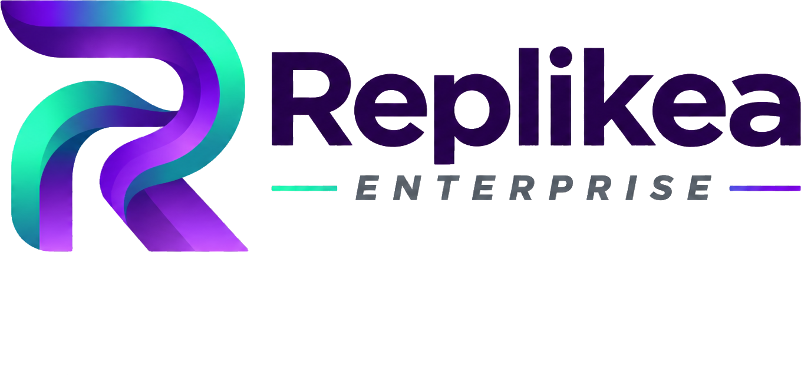

# Replikea Enterprise

<p align="center">
  
</p>

<p align="center">
  An enterprise retail management application built with ASP.NET Core and React.
</p>

---

## Overview

**Replikea Enterprise** is an enterprise application designed to explore and implement modern software architecture, backend development, frontend engineering, authentication, and business workflows.

The application uses ASP.NET Core for backend services and React with TypeScript for the frontend.

The project focuses on building a maintainable, scalable application while following enterprise software development practices.

## Technology Stack

### Backend
- ASP.NET Core
- C#
- Entity Framework Core
- SQL Server
- RESTful APIs

### Frontend
- React
- TypeScript
- Vite
- CSS

### Authentication and Security
- JWT-based authentication
- Access and refresh tokens
- HttpOnly cookies
- Session management

## Architecture

Replikea follows a layered backend architecture with a separate frontend application.

- **Frontend:** Handles presentation, user interactions and communication with backend APIs.
- **API Layer:** Acts as the entry point for frontend requests and coordinates application operations.
- **Application Layer:** Handles application use cases and business logic orchestration.
- **Infrastructure Layer:** Handles persistence, external service integrations and infrastructure concerns.

The frontend communicates with the backend through HTTP APIs.

## Project Structure

```text
Replikea/
├── Backend/
│   ├── Replikea.Api/
│   ├── Replikea.Application/
│   └── Replikea.Infrastructure/
│
├── Frontend/
│   └── Replikea-web/
│
├── Documentation/
│   └── assets/
│
└── README.md
```

## Current Development Scope

The initial development focuses on establishing the application foundation.

- Frontend setup using React and TypeScript.
- Backend API setup using ASP.NET Core.
- User registration and login.
- JWT access-token authentication.
- Refresh-token management.
- HttpOnly cookie-based refresh-token storage.
- Session restoration and logout.
- Frontend and backend integration.

Additional retail business workflows will be introduced as development progresses.

## Getting Started

### Prerequisites

Install the following:

- .NET SDK
- Node.js and npm
- SQL Server
- Git

### Clone the Repository

```bash
git clone <https://github.com/JSTeja3/Replikea.git>
cd Replikea
```

### Backend Setup

Open the backend solution in your preferred development environment.

Configure the required database connection strings and authentication secrets using .NET User Secrets or environment variables.

Restore dependencies and run the API project.

### Frontend Setup

Navigate to the frontend application:

```bash
cd Frontend/Replikea-web
npm install
```

Configure the frontend API URL in `.env.development`:

```env
VITE_API_BASE_URL=http://localhost:5031
```

Start the development server:

```bash
npm run dev
```

## Documentation

Detailed technical documentation and design decisions are maintained in the `Documentation/` directory.

Documentation will cover:

- System architecture
- Backend and frontend architecture
- Authentication and authorization
- Database design
- Business workflows
- API design
- Architecture Decision Records (ADRs)

## Roadmap

The project will evolve through the following areas:

- [x] Initial backend and frontend setup
- [x] Authentication API integration
- [x] Registration and login flows
- [x] Session management
- [ ] Enterprise application dashboard
- [ ] Product management
- [ ] Inventory management
- [ ] Purchasing workflows
- [ ] Supplier management
- [ ] Role-based access control
- [ ] Cloud deployment

*The roadmap represents development goals and may change as the application evolves.*

---

<p align="center">
  Built as an ongoing enterprise software engineering project.
</p>